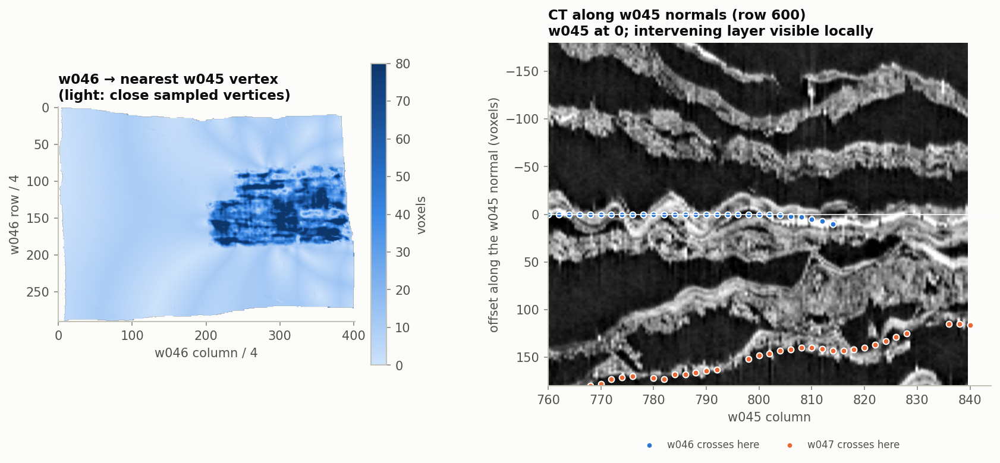
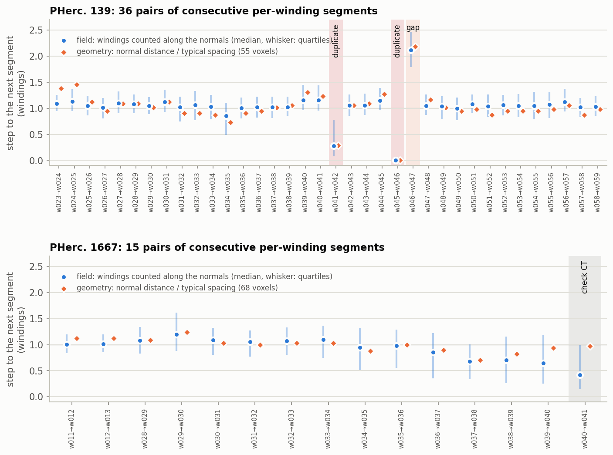
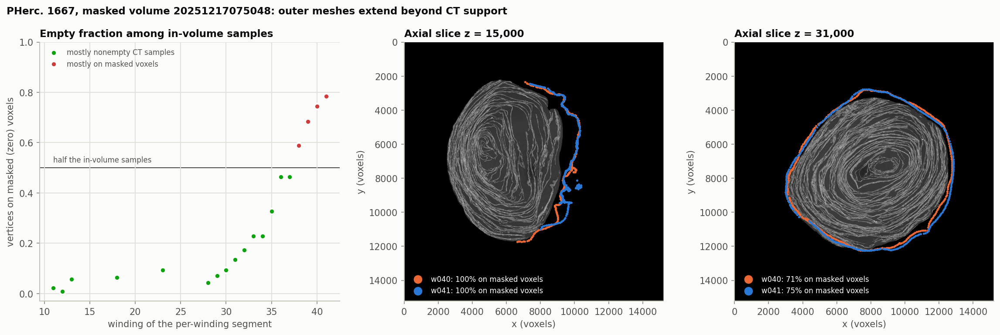
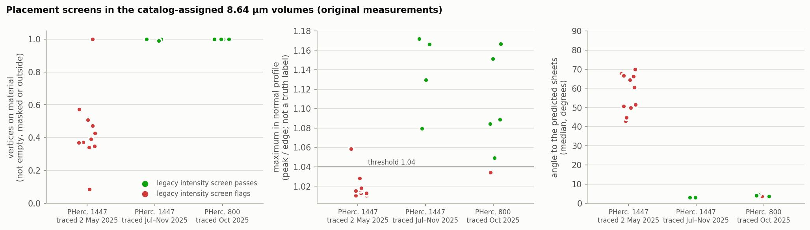
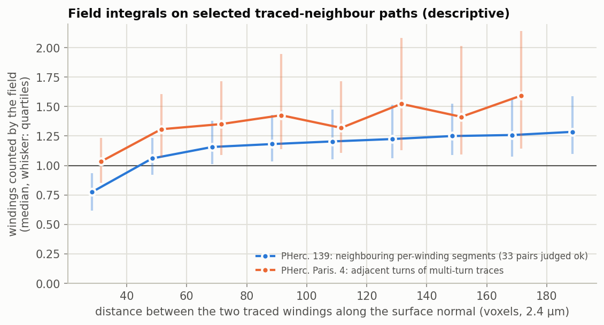
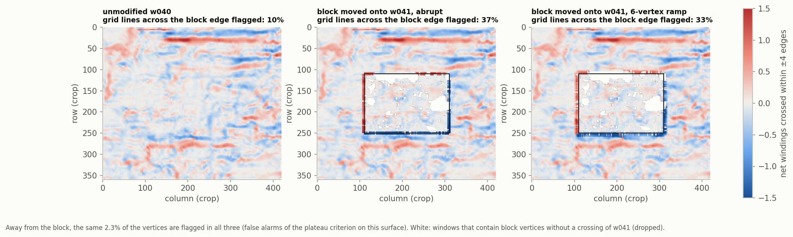

# winding-audit

CPU screening of per-winding `tifxyz` meshes against their geometry, published Lasagna fields and CT support.

The useful result is a short, reproducible list of **label/coverage inconsistencies for an annotator to inspect** before using a mesh as winding evidence. The tool does not establish absolute winding identity, automatically repair registrations, or certify a surface as anatomically correct. Lasagna is derived from CT; these are complementary observations, not statistically independent ground truths.

Version 0.1.1 includes a separate code and data review of the supplied 0.1.0 package. See [REVIEW.md](REVIEW.md), [CHANGELOG.md](CHANGELOG.md), [RELATED_WORK.md](RELATED_WORK.md) and `results/review/` for what was actually rerun. JSONs directly under `results/` retain the original experiment outputs; they are not silently relabelled as new runs.

## Main observations

| Case | Measurement | Interpretation and limit |
|---|---|---|
| PHerc. 139, w045/w046 | 82.328% of every-fourth-grid samples from w046 are within 12 base voxels of a w045 vertex; median 7.892 voxels | Strong, independently reproduced evidence of predominant geometric overlap. These are directional vertex counts, **not area fractions**. About 12.86% are at least 30 voxels away; the whole segment is not a duplicate. |
| PHerc. 139, w046/w047 | Original chain output: field median 2.117 windings; normal-distance median 120 voxels, or 2.182 times the chain's typical spacing | A local gap/label inconsistency candidate. A reproduced CT strip shows an intervening bright layer. This does **not** prove winding 46 is absent everywhere or that the absolute numbers are correct. |
| PHerc. 139, w041/w042 | Original directional overlap fraction 47.99%; field-count median 0.280 | Substantial partial overlap; the geometry-only review reproduces 47.999% at grid stride 4. A fresh field-count rerun of this pair remains outstanding. |
| PHerc. 1667, w040/w041 | At z=15,000: 99.59% and 100% of the tested slice vertices fall on CT intensity ≤1; estimated median distances to nonzero slice support 422 and 546 voxels, maximum about 1,284 voxels | Independently reproduced mismatch between these transformed meshes and this **masked** scan's support. Missing material and registration error cannot be distinguished from that scan alone. |
| PHerc. 1447, May versus later meshes | Original full 1,500-vertex screens: all 11 May meshes flag, versus 4 later passes; median normal angles 42.94–69.90° versus 2.86–3.04° | Strong registration/orientation screening candidates, not proof that every point is off papyrus. Smaller-sample CT intensity verdicts can change. Updated checks preserve the CT verdict separately and flag a large orientation disagreement. |

### PHerc. 139: the clearest review target



The distance map is not uniform: a visible patch of w046 lies away from w045. The CT strip is one selected locality (w045 row 600, columns 760–840), not a random sample of the whole scroll. It supports a local intervening-layer interpretation; global winding identity still needs annotation review.

The original 36-pair PHerc. 139 chain flags w041→w042, w045→w046 and w046→w047. The original 15-pair PHerc. 1667 chain flags w040→w041 for inspection. The other pairs are **screen passes**, not independently labelled negative controls. A `duplicate` or `gap` JSON verdict is an algorithmic candidate category.



### PHerc. 1667: CT support is a separate question from winding identity



Volume: `20251217075048-2.399um-0.2m-78keV-masked.zarr`. The meshes were transformed from an older scan. The original 800-vertex, level-3 checks report 59–78% of sampled w038–w041 vertices on empty values, **among points inside the CT interpolation domain**. Outside-array samples are a separate category. Zero CT can be background, an export mask or an omitted fill chunk; it is not a direct anatomical label.

The slice reproducer uses level 4 for the background image, level 2 for support sampling, and a 16-voxel 2D distance-transform grid. Distances to support are slice-based, discretised estimates; they are not distances to a supplied anatomical mask or to the nearest papyrus in 3D.

### PHerc. 1447: keep measurements separate from a verdict



The original metadata links 11 May-2025 and 4 later surfaces to volume `20250521151220`. The date-like IDs and geometric disagreements motivate checking registration provenance; they do not prove when a scan or trace was actually made. No corrective transform has been established.

The original intensity rule used the maximum anywhere in ±12 voxels. Version 0.1.1 additionally requires the mean-profile maximum within a configurable ±3 base voxels. A CT screen pass with a model-normal tilt above 20° is `check_orientation`. Both thresholds are heuristic, not tuned to an independent labelled benchmark. `on_papyrus` means only that this screen passed. Downsampling and sample selection can change the result. Overall, **5 of 6** original PHerc. 800 cases passed the intensity rule, with one borderline failure.

## Descriptive field counts, not an unbiased calibration

The original 33 PHerc. 139 pairs selected as `ok` contain 56,695 spatially correlated paths. On their rounded stored samples:

* Pooled field-count median: **1.0627**, quartiles **0.8628–1.2752**.
* Median of the 33 pair medians: **1.0483**; pair medians range **0.8521–1.1579**.
* Gap bins 20–40 and 140–220 voxels give pooled medians **0.77545** and **1.2639**; all 33 pairs contribute to both bins.



`python scripts/verify_results.py` checks these numbers offline and reports the number of pairs and paths in each bin. Selection uses the same field/geometry screen being described, and a line integral grows with path length even for constant density. Thus the trend alone does not establish the cause of a model bias, justify a new `grad_mag_factor`, or provide 56,695 independent validation examples. The PHerc. Paris. 4 self-hit experiment has the further assumption that the next nonlocal mesh encounter is exactly one physical winding. No fitter improvement from changing these fields has been measured.

## Per-surface maps remain exploratory

`audit` computes signed field integrals along grid edges, sums them over short windows and groups candidate steps and larger disagreements. It exports TIFF maps, JSON and VC3D point collections with **no assigned winding numbers**.

The planted real-data control was rerun: a block of w040 is moved toward the next mesh w041. The median edge steps are **1.104** (abrupt) and **1.086** (ramp). The plateau rule marks **37.14%** and **33.21%** of tested boundary lines, compared with **10%** at those locations on the original surface. Away from the block **2.266%** of vertices are marked. This is one constructed control, with nearest-vertex tolerance and dropped unmatched vertices; it is not a real-switch sensitivity/precision estimate.



On densely wound PHerc. 800, grid edges may be larger than the layer spacing; default windows then have poor interpretability. Do not treat a disagreement map as a corrected mesh or an automatic instruction to alter winding constraints. The PHerc. 814 band interpretation and automatic CT layer-shift estimates are not used as confirmed defects.

## Install and check

```bash
python -m venv .venv
source .venv/bin/activate
python -m pip install -e '.[test]'
python -m pytest -q
python scripts/verify_results.py
winding-audit --help
```

Python ≥3.10. TIFF LZW decoding requires `imagecodecs`, now an explicit dependency. The review ran on Python 3.12; the tested environment is recorded in `requirements-review.txt`. Optional `pyamg` is needed only for the abandoned global-potential experiment.

The tests exercise real on-disk Zarr/blosc decoding as well as synthetic parallel/tilted sheets, planted steps, sentinels, point collections and chain arithmetic. Review regressions cover denied HTTP access, 404 fill semantics, off-centre CT peaks, insufficient samples, empty surfaces, mask mismatches, bounded-memory CT sampling and compressed TIFF input. These engineering tests supplement real-scroll checks; they do not substitute for them.

## Use on real data

A small reproducible chain review, with explicit spacing because three surfaces cannot estimate a representative chain spacing:

```bash
B=https://vesuvius-challenge-open-data.s3.us-east-1.amazonaws.com/PHerc0139
winding-audit chain \
  "$B/segments/20260126000000-w045_2026012619/mesh/20260126000000-on-20260102150214-2.399um.tifxyz/" \
  "$B/segments/20260325000000-w046_20260325/mesh/20260325000000-on-20260102150214-2.399um.tifxyz/" \
  "$B/segments/20260206000001-w047_2026020613/mesh/20260206000001-on-20260102150214-2.399um.tifxyz/" \
  --lasagna "$B/representations/predictions/lasagna/20260102150214-lasagna-20260419180421-L2/PHerc0139-20260102150214-lasagna-20260724.lasagna.json" \
  --spacing 55 --out chain.json
```

Other commands:

```bash
winding-audit placement <surface> --volume <OME-Zarr root> --lasagna <manifest> --out placement.json
winding-audit audit <surface> --lasagna <manifest> --ct <OME-Zarr root> --out audit/
winding-audit calibrate <surface-k> <surface-k+1> --lasagna <manifest>
python scripts/review_placement.py --samples 1500
CACHE=.winding_audit_cache bash scripts/reproduce_all.sh
```

The full workflow writes under `reproduced-0.1.1/results/` by default, preserving bundled snapshots. Set `RUN_DIR` to choose another working directory. It can take tens of minutes or longer, depending on network and cache, and can download gigabytes. The earlier 50-minute/9-GB estimate was not independently benchmarked. CT decoding now processes at most eight chunks concurrently and retains none between calls; field and surface caches still grow and have no quota. Long chain runs checkpoint completed pairs (`complete: false` until finished). The catalog is live: source URLs, parameters and local checksums must be retained for any published run. `results/review/source_snapshot.json` records the reviewed selection; it is not a hash lock of every remote voxel chunk.

## Method and boundaries

* Coordinates must already be in the chosen CT/field's **base-voxel xyz frame**. No registration is estimated. CT pyramid levels are assumed isotropic powers of two; other pyramids are unsupported.
* Lasagna channel spacing is `2^scaledown * source_to_base` in base voxels; density is `byte * grad_mag_factor / grad_mag_encode_scale`. Normal decoding follows the compact `(nx, ny)` representation with nonnegative reconstructed `nz`. Unoriented samples use a principal axis tensor; signed edge sampling aligns corner normals to the mesh reference. This is not a bitwise-parity claim against VC3D. All eight corners must carry predictions, a conservative validity rule that differs from current upstream handling of partially invalid normal corners.
* Chain normal hits are closest-vertex approximations sampled at 2-voxel increments and a 12-voxel hit tolerance, not exact ray/triangle intersections. Coincidence is directional. Typical spacing is a global chain median and can misclassify local compression or variable pitch.
* In 0.1.1 geometric distances include normal hits even where field values are invalid; field coverage counts are reported separately. Fewer than 20 valid field paths cannot produce an `ok`/field-based gap verdict. Dominant geometric overlap is still flagged separately.
* HTTP 403 and exhausted transient failures stop the read. Only 404/absent local chunks use the Zarr fill value. A nonzero fill value, missing chunks or masked data must not be interpreted as anatomy without export provenance. Clear old caches before comparing reader versions: a 0.1.0 cached 403 may have been stored as a missing chunk.
* There is no blinded anatomical adjudication, matched runtime/accuracy benchmark against existing QA tools, measured reading gain, or corrected-constraint spiral-fit experiment. No source meshes are modified. Missing numeric observations in CLI/report JSON are written as `null`, not nonstandard NaN or Infinity.

## Data, license and attribution

Code: MIT. Figures, bundled CT crops and data-derived arrays: CC BY-NC 4.0 unless the corresponding asset specifies otherwise. The MIT code license does not relicense the source data.

Newer scans: Angelotti et al., *Vesuvius Challenge — CT Scans of Herculaneum Papyri*. For any legacy pre-2025 DLS scans, cite Parsons et al. (2023), *EduceLab-Scrolls: Verifiable Recovery of Text from Herculaneum Papyri using X-ray CT*, DOI [10.48550/arXiv.2304.02084](https://doi.org/10.48550/arXiv.2304.02084). See [official data attribution](https://scrollprize.org/data). Trace, model and catalog credit belongs to the Vesuvius team and community.

Developed with substantial assistance from Claude Code; subsequently reviewed and revised with OpenAI Codex. Automated test execution and automated raw-data reproduction are distinguished from personal human inspection. No personal code review or CT adjudication by Jonas is asserted.
